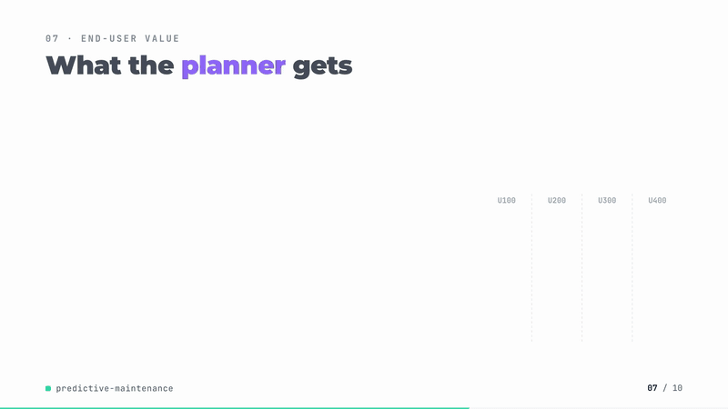
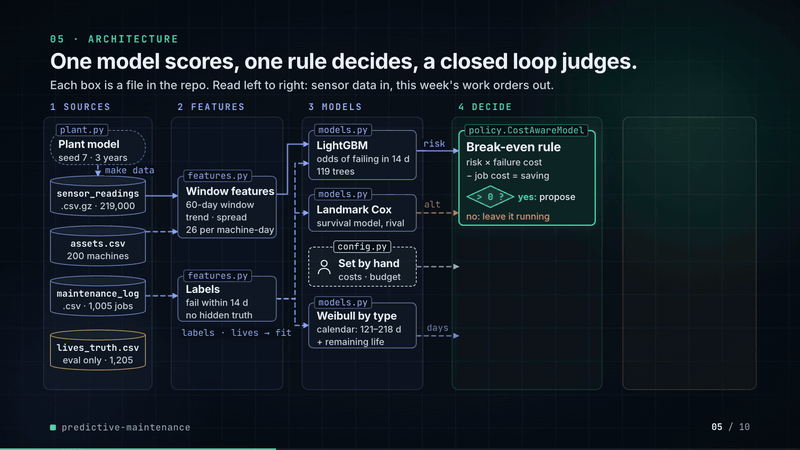

# predictive-maintenance

[](https://github.com/kavya2693/predictive-maintenance/actions/workflows/ci.yml)

Picks which pumps, compressors and heat exchangers the crew should service this week when it
cannot reach them all, and shows what that choice does to uptime and cost against calendar
maintenance and running to failure.

[](docs/demo/demo.mp4)

*86-second silent walkthrough. Click for the full video ([MP4, 4.8 MB](docs/demo/demo.mp4)).*

📄 **Audit report:** every figure and assumption in the video, traced to its source — [PDF](docs/demo/AUDIT_REPORT.pdf) · [Word](docs/demo/AUDIT_REPORT.docx) · [Markdown](docs/demo/AUDIT_REPORT.md)

## At a glance

| | |
|---|---|
| **Problem** | A 200-asset process plant (110 pumps, 40 compressors, 50 heat exchangers) has a crew for about six planned jobs a week. Calendar maintenance with postponements leaves 130 to 157 unplanned failures a year, each costing three to five days of throughput plus the repair. |
| **Approach** | Rolling 60-day sensor features feed a LightGBM "fails in the next 14 days" model; a job is proposed when probability times failure cost beats the cost of the job, and a crew-budgeted scheduler takes the highest expected savings. Seven policies run a full year from the same plant fork, five times over, scored against each asset's latent failure day. |
| **Result** | Against Weibull-optimal calendar maintenance: uptime **99.47% vs 99.00%**, unplanned failures **44.2 vs 111.2** a year, cost **2.02M vs 4.01M** a year; **68.7%** of would-be failures caught. Better than every runnable policy on uptime in all five paired forks. |
| **What didn't win** | Cox had the best ranking (C-index 0.779 vs 0.753) and caught only 29.3% of failures in the closed loop against 68.7%. Hand-set alarm limits get most of the way (the model adds 0.17 pp of uptime over them). Sudden failures are untouched: 1 of 189 caught, 38 of the 44 that remain each year. |

## Architecture

```mermaid
flowchart LR
    subgraph SRC["Sources"]
        CFG["Plant layout, lives, costs<br/>config.py"]
        PLANT["Day-by-day plant<br/>plant.Plant"]
        HIST["History under calendar PM<br/>data.run_history · data.tables<br/>scripts/generate_data.py"]
        ASSETS[("assets.csv<br/>200 assets")]
        READ[("sensor_readings.csv.gz<br/>219,000 daily rows")]
        MLOG[("maintenance_log.csv<br/>1,005 jobs")]
        LIVES[("lives_truth.csv<br/>evaluation only")]
    end

    subgraph FEAT["Data and features"]
        WF["Rolling window features<br/>features.window_features"]
        TBL["Asset-day table<br/>features.build_table"]
        LBL["Observable labels<br/>features._labels"]
        LAT["Latent labels<br/>features.latent_labels"]
    end

    subgraph MOD["Models"]
        GBM["LightGBM p(fail in 14 d)<br/>models.GBMModel"]
        COX["Landmark Cox<br/>models.CoxModel"]
        WEIB["Weibull per type<br/>models.WeibullByType · AgeHazard"]
        RUL["Weibull AFT remaining life<br/>models.RemainingLife"]
    end

    subgraph DEC["Decision"]
        CAM["Break-even rule, rank by saving<br/>policy.CostAwareModel"]
        BASE["Baselines: fixed-interval,<br/>alarm limits, run-to-failure<br/>policy.py"]
        ORC["Oracle, upper bound<br/>policy.Oracle"]
        SCHED["Crew scheduler<br/>policy.schedule · policy.Crew"]
        WO["Work orders + validator<br/>workorders.build · validate"]
    end

    subgraph EVAL["Evaluation"]
        FORK["Replay to day 730, fork<br/>plant.Plant.fork"]
        LOOP["Closed loop, 5 forks x 365 d<br/>simulate.run_policy"]
        OFF["Offline scoring, held-out year<br/>evaluate.py"]
    end

    subgraph OUT["Outputs"]
        RES[("outputs/results.md<br/>results.json · closed_loop_runs.csv")]
        WOJ[("outputs/work_orders.json")]
    end

    CFG --> PLANT
    PLANT -->|"daily readings, jobs, latent lives"| HIST
    HIST --> ASSETS & READ & MLOG & LIVES
    READ -->|"60-day sensor windows"| WF
    MLOG -->|"days since service"| WF
    ASSETS -->|"asset type"| WF
    WF -->|"26 features per asset-day"| TBL
    MLOG -->|"next event per asset-day"| LBL
    TBL -->|"features, years 1-2"| GBM
    LBL -->|"label, censored days dropped"| GBM
    TBL -->|"weekly landmarks"| COX
    LBL -->|"time to next event"| COX
    MLOG -->|"observed lives"| WEIB
    MLOG -->|"observed lives + duty"| RUL
    GBM -->|"p"| CAM
    COX -->|"p"| CAM
    WEIB -->|"age-only p"| CAM
    WEIB -->|"cost-optimal interval per type"| BASE
    CAM -->|"expected saving"| SCHED
    BASE -->|"priority"| SCHED
    ORC -->|"priority"| SCHED
    PLANT -->|"replayed to end of training"| FORK
    FORK -->|"same start, same noise"| LOOP
    SCHED -->|"today's jobs"| LOOP
    LOOP -.->|"previous evening's 60-day window"| WF
    LOOP -.->|"serviced asset renews, 21-day cooldown"| SCHED
    LOOP -.->|"latent remaining life"| ORC
    SCHED -->|"accepted alerts"| WO
    RUL -->|"fleet median remaining life"| WO
    WO -->|"validated JSON"| WOJ
    LIVES -->|"latent failure day"| LAT
    LAT -->|"truth by construction"| OFF
    GBM -->|"held-out year scores"| OFF
    COX -->|"held-out year scores"| OFF
    LOOP -->|"uptime, failures, cost, precision"| RES
    OFF -->|"AP, C-index, lead time"| RES

    classDef data fill:#7fa8ff,stroke:#3d6fd9,color:#0b1020
    classDef model fill:#b9a2ff,stroke:#7a5fd6,color:#0b1020
    classDef decision fill:#3fd8a8,stroke:#1f9c76,color:#0b1020
    classDef evaluation fill:#f2c46d,stroke:#b8902f,color:#0b1020
    classDef risk fill:#ff8a73,stroke:#cc5640,color:#0b1020

    class CFG,PLANT,HIST,ASSETS,READ,MLOG,WF,TBL,LBL,RES,WOJ data
    class GBM,COX,WEIB,RUL model
    class CAM,BASE,SCHED,WO decision
    class FORK,LOOP,OFF evaluation
    class LIVES,LAT,ORC risk
```





Solid edges are the data flow of one run; dotted edges are the closed-loop feedback, where
each day's jobs change the plant the next day's features are read from. Red nodes hold the
latent failure day: they score the policies and the oracle reads them, and nothing on the
training or live-policy path is allowed to touch them.

### Components

| Component | Responsibility | File |
|---|---|---|
| Assumptions | Plant layout, Weibull lives per type, failure modes and precursor lengths, costs, crew budget, LightGBM parameters | [`config.py`](src/predictive_maintenance/config.py) |
| Plant model | Day-by-day assets: latent lives, sensor drift before failure, dropouts and outages, turnaround, repair; `fork` for paired evaluation | [`plant.py`](src/predictive_maintenance/plant.py) |
| History generator | Runs the plant three years under the old calendar policy with postponements and writes the four tables | [`data.py`](src/predictive_maintenance/data.py), [`scripts/generate_data.py`](scripts/generate_data.py) |
| Features and labels | One `window_features` for training and live scoring; observable labels with censored days dropped; latent labels for evaluation | [`features.py`](src/predictive_maintenance/features.py) |
| Models | LightGBM 14-day classifier, landmark Cox, Weibull per type with age-replacement optimum, Weibull AFT remaining life | [`models.py`](src/predictive_maintenance/models.py) |
| Policies and scheduler | Seven policies behind one `score` interface; crew capacity per day and week, 21-day cooldown, ranking by expected saving | [`policy.py`](src/predictive_maintenance/policy.py) |
| Closed loop | One policy for one year from a fork; uptime, failures, cost, precision at budget, lead time | [`simulate.py`](src/predictive_maintenance/simulate.py) |
| Offline evaluation | Average precision, weekly precision at budget, lead time by failure mode, C-index | [`evaluate.py`](src/predictive_maintenance/evaluate.py) |
| Work orders | JSON hand-off to the maintenance system with risk, sensor evidence and schedule window; validator | [`workorders.py`](src/predictive_maintenance/workorders.py) |
| Orchestrator | One command: generate if missing, train, score offline, run the closed loop and sweep, write outputs | [`cli.py`](src/predictive_maintenance/cli.py) |

### Design decisions

| Decision | Options considered | Chosen | Trade-off |
|---|---|---|---|
| How policies are judged | Offline precision@k on the old policy's history; closed-loop replay | A year in the closed loop from one fork, same random stream, five forks ([ADR-0001](docs/adr/0001-judge-policies-in-closed-loop.md)) | Measures what an alert does to the future, but only on a plant whose physics are an assumption; the biggest gap in the limitations |
| Training labels | Censored days as negatives; observable-only labels | Positive if a corrective job starts within 14 days, negative if the next event is more than 14 days out, dropped otherwise | Fewer training rows, no bias toward "whatever planners serviced was healthy" |
| Ground truth for scoring | Observed failures only; a model as judge; latent failure day | Latent failure day recorded by the plant for every life | An alert is scored against the failure it prevented, by construction; the same truth is unavailable on a real plant, where job close-out findings would stand in |
| When to propose a job | Fixed probability threshold (0.5); top-k by probability; cost break-even | `p x failure cost > planned job cost`, ranked by expected saving | Sends the crew to a compressor before a pump at the same risk; leaves capacity idle when nothing clears break-even (seen above six jobs a week) |
| Which risk model drives the crew | Weibull on age only; landmark Cox on sensors; LightGBM on sensors | LightGBM, with Cox and Weibull kept as comparators and for the remaining-life view | Cox ranks better over months (C-index 0.779 vs 0.753) but is not sharp at 14 days; the choice was made in the closed loop, not on concordance |
| Feature code paths | Separate batch and live feature code; one function | One `window_features`, with a test that rebuilds a live day from the CSVs | No train/serve skew from duplicate code; daily summaries only, no vibration spectra |

### Data contracts

| Stage | Input | Output |
|---|---|---|
| Generator | seed (7), `config.py` | `assets.csv`: `asset_id, asset_type, functional_location, last_service_date`; `sensor_readings.csv.gz`: `date, asset_id, load_pct, ambient_c` (float), `vibration, temperature, pressure, flow, current` (float, NaN when missing), `status` (running / failed / planned_job / turnaround); `maintenance_log.csv`: `date, asset_id, kind` (preventive / corrective), `failure_mode, downtime_days` (int), `cost` (float); `lives_truth.csv`: `asset_id, start_day, end_day, ended_by, mode, life_days, latent_failure_day` |
| Features | 60-day window per asset `(m, 60, 5)`, load window `(m, 60)`, days since service, type index | `(m, 26)` float matrix: per sensor `rel3, rel7, slope14, sd7` against the asset's own baseline, `load_m7, load_rel3, days_since_maint`, three type one-hots |
| Asset-day table | the three observable tables | one row per asset per day from day 59: the 26 features plus `asset_id, day, running, label` (1 / 0 / NaN), `time_to_event, event_is_failure` |
| Models | feature rows | `predict(X) -> p` in [0, 1] for the 14-day horizon; Weibull: interval per type; AFT: median remaining days |
| Policy and scheduler | `Observation`: day, features as of the previous evening, days since service, type, eligibility | `Alert`: `day, asset, probability, features` (plus latent remaining life and mode, read only for scoring) |
| Work order | accepted alerts, assets, remaining life | JSON `schema_version, work_order_id, created_on, order_type, priority` (1-3), `asset{}`, `risk{failure_probability, horizon_days, fleet_median_remaining_life_days, expected_saving}`, `evidence[]` (top three sensor moves), `schedule{}`, `estimated_cost` |

### Failure modes and fallbacks

| Failure | What the code does |
|---|---|
| Sensor reading missing (1.5% of days, multi-day outages, no vibration or current probe on heat exchangers) | The reading stays NaN in the window. Medians and spreads ignore NaN, a slope needs at least five points or is NaN, LightGBM routes missing values natively, Cox treats a missing deviation as no deviation, and the alarm-limit rule treats it as no alarm. |
| Single-day sensor spikes | Baselines and recent levels are medians, so one spike moves `rel3` and `rel7` little; the baseline also excludes the last 14 days so a developing fault does not raise its own bar. |
| Asset in repair, or serviced in the last 21 days | Not offered to the crew that day. |
| Weekend, annual turnaround, or the week's crew budget spent | Capacity is zero; nothing is scheduled. The weekly budget resets on Monday and no day takes more than `ceil(K/5)` jobs. |
| No policy score clears break-even | No job is proposed; spare crew capacity goes unused rather than spent on low-value work. |
| Asset with no maintenance events in the log | A sentinel at the end of the data labels it; this case crashed the feature-parity test on its first run and is now covered. |
| Work order fails validation | The run stops with the list of problems (`assert not bad`) rather than writing an order the receiving system would reject. |
| Fork does not match the logged history | The run stops: the number of events in the forked plant must equal the number of jobs in the training log. |
| Model degrades or drifts | Not handled. Models are retrained on every run and are not monitored; the limitations note that a deployed model would need retraining once its own jobs dominate the log. |
| Solver or LLM timeout | Not applicable: scheduling is a sort under a budget, and there is no solver, LLM, model server or network call in the pipeline. |

### Path to production

This is a mapping of each local piece to what would replace it in a deployed system, not a
description of one that exists.

| Here | Production equivalent |
|---|---|
| Seeded plant writing CSVs to `data/` | Process historian (daily or hourly aggregates per tag) and the maintenance system's order history, landed in a warehouse (BigQuery, Snowflake or Redshift) partitioned by date |
| `make run` on a laptop | A daily scheduled job in Airflow or Step Functions: pull yesterday's readings, build features, score, schedule, emit orders before the morning planning meeting |
| LightGBM retrained each run | Versioned model in a registry (MLflow, SageMaker or Vertex AI), retrained monthly on observable labels, promoted only if it beats the incumbent on a held-out window |
| `work_orders.json` | Notifications or orders posted to the maintenance system's API, mapped to its order types and functional location codes, with planner accept or reject captured back |
| Closed loop against latent lives | Shadow mode first: the model's list next to the planners' for a quarter, scored on job close-out findings (was the bearing actually worn) and on failures that followed |
| Daily summaries | Vibration spectra from the condition-monitoring system as extra features, for earlier bearing detection |
| Monitoring (not built) | Weekly precision at budget from close-out findings; failures per month against the calendar baseline; share of missing readings per sensor; feature drift on `rel7` and `days_since_maint`; an alert when the model's own jobs exceed half of recent maintenance history, which is the retraining trigger |

## The problem

A process plant runs 200 assets that matter: 110 pumps, 40 compressors and 50 shell-and-tube
heat exchangers. The maintenance crew can fit in about six planned jobs a week on top of
breakdowns. Today the plant services each asset on a calendar interval per type, and planners
push about a third of those jobs back when production is tight. The result is roughly 140
unplanned failures a year, each costing three to five days of lost throughput plus the
repair, while many of the calendar jobs open up machines that had months of life left.

The reliability engineer has a sensor historian (daily vibration, temperature, pressure, flow
and motor current per asset) and a maintenance log. What she does not have is a way to turn
those into "these six assets this week", or any way to know, before committing a crew to a
model's list for a year, whether that list beats the calendar.

## Why it is hard

Capability is not the obstacle; a gradient-boosted model finds a bearing fault in vibration
data easily. Three other things are.

The labels are censored by the maintenance itself. A pump that got a preventive job never
shows whether it would have failed, so naive labels teach a model that whatever the planners
chose to service was healthy.

Alerts change the future. Once an asset is serviced its next failure moves, so offline
accuracy on last year's history does not say what a policy would do to uptime. And the crew
is the constraint: a model that ranks the whole fleet well over months is not necessarily
good at choosing this week's six jobs.

## The approach

Rolling features over a 60-day sensor window feed a LightGBM classifier for "fails in the
next 14 days". A landmark Cox model on the same features and a Weibull model on asset lives
give the survival view: the Weibull fit sets the cost-optimal calendar interval for the
fixed-interval baseline and puts a fleet remaining-life figure on each work order. A job is
proposed when the probability times the failure cost exceeds the cost of the planned job, and
the scheduler takes the highest expected savings up to the week's crew budget. Accepted jobs
leave as JSON work orders for the maintenance system.

The key decision is how the policies are judged. Training uses only labels a plant could
observe (days whose outcome a preventive job hid are dropped). Evaluation uses the latent
failure day the plant model records for every asset life, so an alert can be scored against
the failure it prevented. And every policy runs a full year in a closed loop: the plant is
replayed to the end of the two-year training history, forked, and each policy starts from the
same fork with the same random stream, five times over. See
[ADR-0001](docs/adr/0001-judge-policies-in-closed-loop.md).

## The result

One year in the closed loop, crew budget six planned jobs a week, mean of five forks
(`outputs/results.md`):

| policy | uptime | unplanned failures | planned jobs | precision at budget | alert within 30 d of a failure | failures caught | cost per year |
|---|---|---|---|---|---|---|---|
| run-to-failure | 98.85% | 223.6 | 0 | - | - | 0% | 5.27M |
| fixed-interval (Weibull-optimal) | 99.00% | 111.2 | 310.0 | 3.7% | 8.6% | 9.3% | 4.01M |
| alarm limits (hand-set) | 99.30% | 58.2 | 279.6 | 30.8% | 49.4% | 59.6% | 2.70M |
| Weibull age only | 98.84% | 223.2 | 8.0 | 12.5% | 12.5% | 0.4% | 5.29M |
| Cox on sensors | 99.19% | 128.6 | 110.2 | 48.2% | 85.2% | 29.3% | 3.40M |
| **gradient boosting on sensors** | **99.47%** | **44.2** | 211.4 | 45.6% | 84.3% | **68.7%** | **2.02M** |
| oracle (knows latent lives) | 99.65% | 2.0 | 237.4 | 100% | 100% | 99.2% | 1.12M |

Precision at budget is the share of jobs on an asset whose latent life would have ended
within the 14-day horizon. Median lead between alert and the averted failure is 7.7 days.
Paired on the same forks, the gradient-boosted policy beats every other runnable policy on
uptime in all five: by +0.62 pp over run-to-failure (cost -3.25M), +0.47 pp over the
calendar (-1.99M), +0.28 pp over Cox (-1.39M) and +0.17 pp over the hand-set alarm limits
(-0.68M).

Offline, on the held-out third year (latent base rate 3.17%):

| model | average precision | C-index | gradual failures flagged ≥ 2 days ahead | median lead |
|---|---|---|---|---|
| alarm limits | 0.282 | 0.647 | 89.7% | 12 d |
| Weibull age only | 0.061 | 0.660 | 0% | - |
| Weibull AFT remaining life | - | 0.742 | - | - |
| Cox on sensors | 0.438 | **0.779** | 49.2% | 15 d |
| gradient boosting | **0.681** | 0.753 | **97.6%** | 15 d |

What disappoints, or contradicts the headline:

- **Sudden failures are untouched.** About one failure in six has no precursor in any
  sensor. The model caught 1 of 189 across the five forks; they are 38 of the 44 failures a
  year that remain under the best policy, and almost all of the gap to the oracle.
- **The hand-set alarm limits get most of the way.** Against the calendar the model adds
  0.47 pp of uptime; against simple per-sensor limits it adds 0.17 pp. Most of the value is in
  watching the sensors at all, not in the model.
- **The best ranking model was the second-worst sensor policy.** Cox has the highest
  concordance (0.779 against 0.753) and catches only 29% of failures in the closed loop
  against 69%. It orders the fleet well over months but is not sharp at the 14-day horizon, so
  few of its probabilities clear the break-even and the crew sits idle. Concordance alone
  would have picked the wrong model.
- **Precision at budget is 46%.** Half the jobs land on an asset that would not have failed
  inside 14 days. 84% land within 30 days of a failure, so most are early rather than wrong,
  but under the strict definition they are false alarms.
- **Uptime moves less than cost.** A failure costs three to five days out of 365, so the
  whole range from run-to-failure to oracle is 0.8 pp of uptime. Cost carries the
  difference: 5.27M to 2.02M a year.

The crew budget sweep shows where the constraint binds:

| policy | 3 jobs/wk | 6 jobs/wk | 10 jobs/wk |
|---|---|---|---|
| fixed-interval | 98.98% / 7% | 99.00% / 4% | 99.03% / 6% |
| alarm limits | 99.24% / 63% | 99.30% / 31% | 99.28% / 27% |
| gradient boosting | 99.37% / 74% | 99.47% / 46% | 99.47% / 44% |
| oracle | 99.41% / 100% | 99.65% / 100% | 99.65% / 100% |

(uptime / precision at budget). At three jobs a week the model is within 0.04 pp of the
oracle: when the crew is short, choosing well is nearly solved. Above six it stops using the
extra capacity, because the break-even rule finds nothing else worth a job.

## How it works

```
 sensor historian ──┐                                        ┌── work orders (JSON) ──> maintenance system
 (daily readings)   │                                        │
                    ├─> window_features ─> model ─> policy ──┤
 maintenance log ───┘   60-day window       p(14d)  p*Cf>Cp  └── crew scheduler: top expected
 (days since service)   rel3/rel7/slope/sd          rank by       saving, <= ceil(K/5) a day,
                                                    saving        <= K a week, 21-day cooldown
```

Each day in the closed loop the scheduler asks the policy to score every asset it could reach (not in
repair, not serviced in the last 21 days) using features as of the previous evening, takes
the top scores within the remaining crew budget, and the plant steps forward with those jobs
done. A planned job costs 1,500 plus one day of downtime and renews the asset. A failure
costs its repair (9k to 22k by type) plus three to five days of downtime at 3,000 a day.

| file | what it does |
|---|---|
| `config.py` | plant layout, Weibull lives, failure modes and precursor lengths, costs, crew budget |
| `plant.py` | day-by-day plant: latent lives, sensor drift before failure, dropouts, turnaround |
| `data.py` | runs the plant under the old calendar policy and writes the four tables |
| `features.py` | rolling window features, observable labels, latent labels |
| `models.py` | LightGBM, landmark Cox, Weibull per type with age-replacement optimum, Weibull AFT |
| `policy.py` | the seven policies and the crew-budgeted scheduler |
| `simulate.py` | one policy for one year in the closed loop, and its metrics |
| `evaluate.py` | offline average precision, weekly precision at budget, lead time, C-index |
| `workorders.py` | JSON work orders and the validator that checks them |
| `cli.py` | the one-command run |

## Running it

```bash
git clone https://github.com/kavya2693/predictive-maintenance && cd predictive-maintenance
uv sync
make data     # three years, 200 assets, 219,000 daily readings, seed 7
make run      # trains, scores the held-out year, runs the closed loop; about 2 minutes
make check    # ruff, ruff format, mypy, pytest
```

`make run` writes `outputs/results.md`, `results.json`, `closed_loop_runs.csv` (every
policy, budget and seed), `work_orders.json` (the first two weeks of orders) and `run.log`.
`predmaint --seeds 1 --no-sweep` is the quick version CI runs. With Docker:

```bash
docker build -t predictive-maintenance . && docker run --rm predictive-maintenance
```

No model server, API key or download is needed.

## The data

The dataset is generated by the seeded script `scripts/generate_data.py` and sized to the
production problem (200 assets, three years of daily readings); production historian and
maintenance data of this kind is proprietary.

| table | rows | contents |
|---|---|---|
| `assets.csv` | 200 | asset id, type, functional location, last service before the history starts |
| `sensor_readings.csv.gz` | 219,000 | date, asset, load %, ambient C, vibration, temperature, pressure, flow, current, status |
| `maintenance_log.csv` | 1,005 | date, asset, preventive or corrective, failure mode, downtime days, cost |
| `lives_truth.csv` | 1,205 | latent life and failure mode of every asset life; used only for evaluation |

Each asset life is drawn from a Weibull distribution by type (shape 2.0 to 3.0), shortened
for assets run at higher duty. A life ends in one of seven failure modes, each with its own
sensor signature and warning time: bearing wear raises vibration over about three weeks,
fouling raises exchanger temperature and differential pressure over about five, overheating
gives four days, and sudden failures give nothing. Around that sit an ambient temperature
season, lower weekend and holiday load, a ten-day annual turnaround when nothing runs,
scattered single-day sensor dropouts (1.5%) and multi-day outages, rare spikes, and no
vibration or current probe on heat exchangers.

The history was produced by the plant's old policy (calendar maintenance with postponements),
which gives 143, 130 and 157 failures and 195, 198 and 182 preventive jobs in the three years.

## Tests

`make check` runs 19 tests in about seven seconds. The two that matter most:

- `test_offline_and_live_features_agree` runs a plant day by day, captures the features the
  scheduler would see on one day, then rebuilds the same day from the written CSV tables and
  checks they match. Train/serve skew is the usual way a maintenance model works in a
  notebook and fails on the line.
- `test_precision_metric_sees_through_a_coin_flip` runs a random policy through the closed
  loop and checks precision at budget stays low, while the oracle scores 1.0. The metric was
  tested against a deliberately useless policy before it was trusted on a real one.

Others check that bearing faults show in vibration before failure and sudden failures do
not, that a fork gives every policy the same future for assets it does not touch, that the
crew budget is never exceeded, that age replacement only pays when the Weibull shape is above
one, that censored days are dropped from the labels, and that every work order validates.

## Known limitations

- **The biggest gap: the same plant model generated the training data and runs the
  evaluation.** The precursor lengths and signatures are assumptions. The model is learning
  the shape the generator put there, so the numbers say the method works on a plant with
  these physics, not what it would achieve on a given real plant. On real data the first job
  would be measuring how much warning each failure mode actually gives.
- Daily summaries only. Real vibration monitoring uses spectra (bearing defect frequencies),
  which would detect some faults earlier than a daily RMS.
- Every job is a perfect repair: a serviced asset is as good as new. Imperfect repair and
  infant mortality after a job are not modelled.
- One downtime cost for every asset. Assets with an installed spare should cost far less to
  lose, which would change the ranking.
- The crew is one pool; mechanical, rotating and static crews are not separate budgets, and
  spare-part lead times are ignored.
- The model is trained on history produced by the calendar policy and then deployed under
  its own policy, where days since service look different. It held up here, but on a real
  plant it would need retraining once its own jobs dominate the log.
- The Cox model uses landmark snapshots rather than a full time-varying fit, and its
  probabilities are not recalibrated.
- The work order schema is generic. Mapping it to a particular maintenance system's order
  type, notification and functional location codes is integration work not done here.

## Insights and learning

I picked this because "predict failures" is easy to demo and hard to defend: a high AUC on a
held-out table says nothing about what a crew of six should do on Monday. Building the closed
loop first, with the latent lives recorded, changed what the project was about. The model
became one policy among seven, and the question became which policy to trust with the crew.

The surprise was Cox. I expected the survival model and the classifier to tell the same
story, and on concordance Cox wins. In the closed loop it catches less than half of what the
classifier catches, because a good ordering over months is not the same as a sharp
probability at two weeks, and the break-even rule only fires on the latter. If I had chosen
the model on C-index, I would have shipped the worse policy.

The second surprise was how much of the value the hand-set alarm limits already capture. The
honest pitch for the model is not "machine learning prevents failures" but "a model on top of
sensors you already watch cuts another quarter off maintenance cost and gets the crew to the
right asset when it is short-staffed".

What I got wrong at first: I scored alerts only against the strict 14-day definition, which
made half the model's jobs look like false alarms. Looking at the latent lives showed most of
those assets were 15 to 30 days from failing, so I added the 30-day reading next to the strict
one rather than replacing it. Both numbers are in the table because they answer different
questions. The feature-parity test also earned its place on its first run: it crashed on a
small plant where one asset had no maintenance events at all, a case the full dataset never
hit.

Next I would add an imperfect-repair model and separate crews, then try a policy that also
chooses when to inspect rather than only when to repair, since an inspection is cheaper than
a job and would buy information on the assets the model is unsure about.

## License

MIT
