# predictive-maintenance: demo video audit report

**Repository:** https://github.com/kavya2693/predictive-maintenance  
**Numbers taken from commit:** `70531ff` (outputs last changed in `70531ff (2026-10-13 21:58:39 +0400)`)  
**Video:** `docs/demo/demo.mp4` (86.0 s, 1920x1080, 30 fps, silent)  
**Generated:** 2026-10-14 14:37  
**Automated checks:** 62 pass · 0 fail · 1 manual (of 63 figures)

## How to use this report

Every number or claim on screen has an ID (`F-01`, `F-02`, ...) and every modelling assumption has an ID (`A-01`, ...). Cite the ID. Each figure lists its source file, the exact column/row/key, the formula for derived numbers, and an automated check result. The change-impact matrix tells you which slides and files change if an input or assumption changes.

Types: **direct** = read straight from a repo output; **derived** = computed from direct values (formula given); **illustrative** = drawing or example, not data; **general knowledge** = context not produced by the repo.

### Regenerate

```bash
make run                                   # data/*.csv + outputs/results.json, closed_loop_runs.csv, work_orders.json (~2 min)
.venv/bin/python docs/demo/source/tools/export_work_orders.py docs/demo/source/assets/plant_run.json   # ~25 s
python3 docs/demo/source/tools/inject_sheet.py docs/demo/source/assets/plant_run.json docs/demo/source/compositions --rows 0,1,2,3,4,5
cd docs/demo/source && npx --yes hyperframes@0.8.156 check && npx --yes hyperframes@0.8.156 render -f 30 -q looks -o renders/predictive-maintenance-master.mp4 && cd -
ffmpeg -y -i docs/demo/source/renders/predictive-maintenance-master.mp4 -c:v libx264 -preset slow -crf 25 -pix_fmt yuv420p -movflags +faststart -an docs/demo/demo.mp4
python3 docs/demo/source/tools/build_audit_report.py docs/demo/source/audit/facts.yaml   # stills, checks, MD/DOCX/PDF
```

## 1. Figures

| ID | Shown on screen | Slides | Source | Column / row / key | How computed | Type | Check |
|---|---|---|---|---|---|---|---|
| F-01 | 3 industry chips | 01 | `author's framing` | - | - | general knowledge | manual: Context statement, not a repo output. |
| F-02 | 4 problem cards | 01 | `README 'The problem' (problems 1-3)` | README lines 10-22 | - | general knowledge | ✓ verified |
| F-03 | 200 machines | 02, 05, 08 | `data/assets.csv` | row count | - | direct | ✓ verified |
| F-04 | About 6 planned jobs a week / crew 6 jobs / week | 02, 08 | `outputs/results.json` | crew_jobs_per_week | - | direct | ✓ verified |
| F-05 | 110 pumps · 40 compressors · 50 heat exchangers | 02 | `data/assets.csv` | asset_type counts | - | direct | ✓ verified |
| F-06 | 219,000 daily sensor readings / .csv.gz · 219,000 | 02, 05 | `data/sensor_readings.csv.gz` | row count | - | direct | ✓ verified |
| F-07 | 130–157 breakdowns a year on the calendar | 02 | `data/maintenance_log.csv` | kind=corrective per year: 143, 130, 157 | min..max of yearly corrective counts | derived | ✓ verified |
| F-08 | SENSORS · SERVICE LOG · RISK MODEL · WORTH A JOB? · CREW PLAN · WORK ORDERS | 03 | `src/predictive_maintenance/` | functions | - | direct | ✓ verified |
| F-09 | fewer breakdowns / lower cost / higher uptime | 03 | `outputs/results.json closed_loop` | gbm-sensors vs fixed-interval at crew 6 | failures, cost_total lower; uptime higher | derived | ✓ verified |
| F-10 | EVERY WORKING DAY | 03 | `src/predictive_maintenance/config.py:107` | working_days = (0..4) | - | direct | ✓ verified |
| F-11 | Replay the plant to today, then fork it | 04 | `src/predictive_maintenance/plant.py:281-293; tests/test_plant.py:48` | fork(); test_fork_gives_every_policy_the_same_future | - | direct | ✓ verified |
| F-12 | Each policy runs a full year | 04 | `src/predictive_maintenance/cli.py (run_policy(..., DAYS_PER_YEAR, ...)); config.py:13` | DAYS_PER_YEAR = 365 | - | direct | ✓ verified |
| F-13 | tick barcodes (no numbers) | 04 | `demo assets/plant_run.json (export_work_orders.py); outputs/closed_loop_runs.csv` | LOOP block in compositions/explainer.html | number of ticks per branch = failures for seed 101, crew 6 | derived | ✓ verified |
| F-14 | 0.779 | 04, 09 | `outputs/results.json` | offline.policies.cox-sensors.c_index | - | direct | ✓ verified |
| F-15 | 0.753 | 04 | `outputs/results.json` | offline.policies.gbm-sensors.c_index | - | direct | ✓ verified |
| F-16 | 29% | 04 | `outputs/results.json closed_loop` | cox-sensors, crew 6, failures_caught_share (0.2929) | x100, rounded | direct | ✓ verified |
| F-17 | 69% | 04 | `outputs/results.json closed_loop` | gbm-sensors, crew 6, failures_caught_share (0.6868) | x100, rounded | direct | ✓ verified |
| F-18 | seed 7 · 3 years | 05 | `src/predictive_maintenance/cli.py (--data-seed default 7); config.py:14` | HISTORY_YEARS = 3 | - | direct | ✓ verified |
| F-19 | .csv · 1,005 jobs | 05 | `data/maintenance_log.csv` | row count | - | direct | ✓ verified |
| F-20 | eval only · 1,205 | 05 | `data/lives_truth.csv` | row count | - | direct | ✓ verified |
| F-21 | observable only | 05 | `src/predictive_maintenance/features.py (_labels); tests/test_features.py:33` | test_labels_drop_rows_a_preventive_job_hides | - | direct | ✓ verified |
| F-22 | plant.py, features.py, models.py (LightGBM, Cox, Weibull, AFT), config.py, policy.py (CostAwareModel, schedule, other policies), workorders.py, simulate.py, evaluate.py | 05 | `src/predictive_maintenance/` | classes and functions | - | direct | ✓ verified |
| F-23 | 60-day window | 05 | `src/predictive_maintenance/config.py:19` | WINDOW_DAYS = 60 | - | direct | ✓ verified |
| F-24 | 26 per asset-day | 05 | `src/predictive_maintenance/features.py:20-28 (FEATURE_NAMES)` | 5 sensors x 4 + load_m7 + load_rel3 + days_since_maint + 3 type flags | 5 x 4 + 3 + 3 = 26 | derived | ✓ verified |
| F-25 | p(fail ≤ 14 d) / fail within 14 d / p(14 d) | 05, 06 | `outputs/results.json` | horizon_days | - | direct | ✓ verified |
| F-26 | 119 trees | 05 | `outputs/results.json` | training.best_iteration | - | direct | ✓ verified |
| F-27 | T* 187·121·218 d | 05 | `outputs/results.json` | fixed_intervals_days | - | direct | ✓ verified |
| F-28 | saving = p·C_fail − C_job; > 0 ? yes: propose | 05 | `src/predictive_maintenance/policy.py:109-110` | saving = p * FAILURE_COST - PLANNED_COST; propose where saving > 0 | - | direct | ✓ verified |
| F-29 | ≤ 2 a day · ≤ 6 a week · 21-day cooldown | 05 | `src/predictive_maintenance/policy.py:144-145; config.py:20, :106-107` | per_day = ceil(6 / 5); COOLDOWN_DAYS = 21 | ceil(6/5) = 2 | derived | ✓ verified |
| F-30 | 7 policies × 5 forks | 05, 10 | `outputs/closed_loop_runs.csv` | distinct policies at crew 6; distinct seeds | - | direct | ✓ verified |
| F-31 | make run ≈ 2 min / ~2 min | 05, 10 | `outputs/results.json` | runtime_seconds = 127.3 | 127.3 / 60 = 2.1 min | derived | ✓ verified |
| F-32 | Planner · accept → CMMS | 05 | `src/predictive_maintenance/workorders.py:1-5 (docstring); README 'Known limitations' (schema mapping not done)` | - | - | direct | ✓ verified |
| F-33 | daily vibration · last 60 days (line chart) | 06 | `data/sensor_readings.csv.gz; demo assets/plant_run.json trace` | asset_id = COMP-141, 2024-11-01..2024-12-30 | values compared to 3 decimals | direct | ✓ verified |
| F-34 | alert · 2024-12-31 | 06 | `outputs/work_orders.json` | [0].created_on | - | direct | ✓ verified |
| F-35 | +52% vs its baseline / vibration +52% | 06, 07 | `outputs/work_orders.json` | [0].evidence[0] = vibration, 0.521 | x100, rounded | direct | ✓ verified |
| F-36 | CBM-2024-00001 · COMP-141 · U200-K-141 · 0.736 · P1 · 2025-01-03 · rotating-equipment | 06 | `outputs/work_orders.json` | [0] | - | direct | ✓ verified |
| F-37 | hidden life ended 1.8 days later (bearing) | 06 | `demo assets/plant_run.json work_orders[0].truth (Plant.latent_remaining at the alert, fork seed 101); corroborated by data/lives_truth.csv (the same life, in the history run, ended by a bearing failure on day 731)` | latent_days_to_failure, latent_mode | - | direct | ✓ verified |
| F-38 | 232 · 138 · 111 · 56 · 43 · 3 | 06 | `outputs/closed_loop_runs.csv (seed 101, crew 6); curves from demo assets/plant_run.json` | failures | - | direct | ✓ verified |
| F-39 | fork 1 of 5 | 06 | `src/predictive_maintenance/config.py:108; demo assets/plant_run.json seed` | eval_seeds[0] = 101 | - | direct | ✓ verified |
| F-40 | CBM-2024-00001 … CBM-2025-00006 | 07 | `outputs/work_orders.json [0:6], injected into compositions/value.html` | work_order_id, asset_id, failure_probability, evidence[0], expected_saving, due_by, crew | p to 2 dp; saving / 1000 to 1 dp; crew shortened (rotating-equipment → rotating) | direct | ✓ verified |
| F-41 | + 6 more orders the following week | 07 | `outputs/results.json` | work_orders_first_two_weeks = 12 | 12 - 6 | derived | ✓ verified |
| F-42 | All 6 pass validate() | 07 | `src/predictive_maintenance/cli.py (assert not bad); tools/export_work_orders.py asserts the same` | validate() | - | direct | ✓ verified |
| F-43 | 5 of 6 were under 14 days from failing | 07 | `demo assets/plant_run.json work_orders[0:6].truth` | latent_days_to_failure: 1.8, 0.3, 5.0, 11.0, 3.3, 18.1 | count(0 < d <= 14) | derived | ✓ verified |
| F-44 | CREW 6 / 6 | 07 | `outputs/work_orders.json` | orders created 2024-12-30..2025-01-03 | count | derived | ✓ verified |
| F-45 | TUE 31 DEC · WED 1 JAN · THU 2 JAN | 07 | `outputs/work_orders.json` | created_on of orders 1-6 | - | direct | ✓ verified |
| F-46 | 99.47% | 08 | `outputs/results.json closed_loop` | gbm-sensors, crew 6, uptime | x100 | direct | ✓ verified |
| F-47 | vs calendar 99.00% | 08 | `outputs/results.json closed_loop` | fixed-interval, crew 6, uptime | x100 | direct | ✓ verified |
| F-48 | +0.47 pp | 09 | `outputs/results.json` | paired_gbm_minus.fixed-interval.uptime_pp_mean | - | direct | ✓ verified |
| F-49 | 44.2 | 08 | `outputs/results.json closed_loop` | gbm-sensors, crew 6, failures | - | direct | ✓ verified |
| F-50 | calendar 111.2 | 08 | `outputs/results.json closed_loop` | fixed-interval, crew 6, failures | - | direct | ✓ verified |
| F-51 | 2.02M | 08 | `outputs/results.json closed_loop` | gbm-sensors, crew 6, cost_total = 2,015,700 | / 1e6 | direct | ✓ verified |
| F-52 | 4.01M | 08 | `outputs/results.json closed_loop` | fixed-interval, crew 6, cost_total = 4,009,400 | / 1e6 | direct | ✓ verified |
| F-53 | 68.7% | 08 | `outputs/results.json closed_loop` | gbm-sensors, crew 6, failures_caught_share | x100 | direct | ✓ verified |
| F-54 | median lead 7.7 days | 08 | `outputs/results.json closed_loop` | gbm-sensors, crew 6, median_lead_days | - | direct | ✓ verified |
| F-55 | the model beat every runnable policy in all 5 forks | 08 | `outputs/results.json` | paired_gbm_minus.*.seeds_gbm_better_uptime | all == 5 | direct | ✓ verified |
| F-56 | +0.30 pp | 09 | `outputs/results.json closed_loop` | alarm-limits uptime - fixed-interval uptime (crew 6) | (0.992978 - 0.989989) x 100 = 0.299 | derived | ✓ verified |
| F-57 | +0.19 pp | 09 | `outputs/results.json closed_loop` | cox-sensors uptime - fixed-interval uptime (crew 6) | (0.991939 - 0.989989) x 100 = 0.195 | derived | ✓ verified |
| F-58 | +0.66 pp | 09 | `outputs/results.json closed_loop` | oracle uptime - fixed-interval uptime (crew 6) | (0.996549 - 0.989989) x 100 = 0.656 | derived | ✓ verified |
| F-59 | 38 of the 44 breakdowns left are sudden | 09 | `outputs/closed_loop_runs.csv` | gbm-sensors, crew 6: mean sudden_failures 37.6, mean failures 44.2 | rounded to whole numbers | derived | ✓ verified |
| F-60 | The model caught 1 of 189 | 09 | `outputs/results.json` | gbm_caught_by_mode.sudden | - | direct | ✓ verified |
| F-61 | MIT | 10 | `LICENSE line 1` | - | - | direct | ✓ verified |
| F-62 | LightGBM · lifelines · closed-loop sim · Python | 10 | `pyproject.toml dependencies; src/predictive_maintenance/simulate.py` | lightgbm, lifelines | - | direct | ✓ verified |
| F-63 | $ make run | 10 | `Makefile` | run target | - | direct | ✓ verified |

## 2. Automated check run (2026-10-14 14:37)

| ID | Expected on slide | Recomputed from repo | Result |
|---|---|---|---|
| F-01 | 3 industry chips | - | manual |
| F-02 | true | true | ✓ pass |
| F-03 | 200 | 200 | ✓ pass |
| F-04 | 6 | 6 | ✓ pass |
| F-05 | 110 pumps · 40 compressors · 50 heat exchangers | 110 pumps · 40 compressors · 50 heat exchangers | ✓ pass |
| F-06 | 219,000 | 219,000 | ✓ pass |
| F-07 | 130–157 | 130–157 | ✓ pass |
| F-08 | true | true | ✓ pass |
| F-09 | true | true | ✓ pass |
| F-10 | true | true | ✓ pass |
| F-11 | true | true | ✓ pass |
| F-12 | true | true | ✓ pass |
| F-13 | true | true | ✓ pass |
| F-14 | 0.779 | 0.779 | ✓ pass |
| F-15 | 0.753 | 0.753 | ✓ pass |
| F-16 | 29% | 29% | ✓ pass |
| F-17 | 69% | 69% | ✓ pass |
| F-18 | true | true | ✓ pass |
| F-19 | 1,005 | 1,005 | ✓ pass |
| F-20 | 1,205 | 1,205 | ✓ pass |
| F-21 | true | true | ✓ pass |
| F-22 | true | true | ✓ pass |
| F-23 | true | true | ✓ pass |
| F-24 | 26 | 26 | ✓ pass |
| F-25 | 14 | 14 | ✓ pass |
| F-26 | 119 | 119 | ✓ pass |
| F-27 | 187·121·218 | 187·121·218 | ✓ pass |
| F-28 | true | true | ✓ pass |
| F-29 | true | true | ✓ pass |
| F-30 | 7 policies × 5 forks | 7 policies × 5 forks | ✓ pass |
| F-31 | ~2 min | ~2 min | ✓ pass |
| F-32 | true | true | ✓ pass |
| F-33 | true | true | ✓ pass |
| F-34 | 2024-12-31 | 2024-12-31 | ✓ pass |
| F-35 | vibration +52% | vibration +52% | ✓ pass |
| F-36 | CBM-2024-00001 · COMP-141 · U200-K-141 · 0.736 · P1 · 2025-01-03 · rotating-equipment | CBM-2024-00001 · COMP-141 · U200-K-141 · 0.736 · P1 · 2025-01-03 · rotating-equipment | ✓ pass |
| F-37 | 1.8 bearing | 1.8 bearing | ✓ pass |
| F-38 | 232 · 138 · 111 · 56 · 43 · 3 | 232 · 138 · 111 · 56 · 43 · 3 | ✓ pass |
| F-39 | true | true | ✓ pass |
| F-40 | true | true | ✓ pass |
| F-41 | 6 | 6 | ✓ pass |
| F-42 | true | true | ✓ pass |
| F-43 | 5 of 6 | 5 of 6 | ✓ pass |
| F-44 | 6 / 6 | 6 / 6 | ✓ pass |
| F-45 | true | true | ✓ pass |
| F-46 | 99.47% | 99.47% | ✓ pass |
| F-47 | 99.00% | 99.00% | ✓ pass |
| F-48 | +0.47 pp | +0.47 pp | ✓ pass |
| F-49 | 44.2 | 44.2 | ✓ pass |
| F-50 | 111.2 | 111.2 | ✓ pass |
| F-51 | 2.02M | 2.02M | ✓ pass |
| F-52 | 4.01M | 4.01M | ✓ pass |
| F-53 | 68.7% | 68.7% | ✓ pass |
| F-54 | 7.7 | 7.7 | ✓ pass |
| F-55 | true | true | ✓ pass |
| F-56 | +0.30 pp | +0.30 pp | ✓ pass |
| F-57 | +0.19 pp | +0.19 pp | ✓ pass |
| F-58 | +0.66 pp | +0.66 pp | ✓ pass |
| F-59 | 38 of 44 | 38 of 44 | ✓ pass |
| F-60 | 1 of 189 | 1 of 189 | ✓ pass |
| F-61 | true | true | ✓ pass |
| F-62 | true | true | ✓ pass |
| F-63 | true | true | ✓ pass |

## 3. Assumptions register

| ID | Assumption | Source | Used by | Sensitivity: if this changes |
|---|---|---|---|---|
| A-01 | All data is synthetic: a seeded day-by-day plant model (200 assets, 3 years) generates the sensor history, the maintenance log and the latent lives. The same plant model also runs the closed-loop evaluation, so results describe a plant with these physics, not a given real plant (README 'Known limitations', the biggest gap). | `src/predictive_maintenance/plant.py; data.py:152-160 (generate, seed 7); config.py:14; README 'The data'` | all figures | figures all figures and slides 01, 02, 03, 04, 05, 06, 07, 08, 09, 10 change |
| A-02 | Failure precursors: each failure mode drifts the sensors for a mode-specific number of days before the failure (bearing 21 d, fouling 35 d, overheating 4 d, ...); sudden failures give no warning. These lengths are assumptions. | `src/predictive_maintenance/config.py:93-101 (PRECURSOR_DAYS)` | F-17, F-34, F-35, F-37, F-53, F-54, F-59, F-60 | figures F-17, F-34, F-35, F-37, F-53, F-54, F-59, F-60 and slides 04, 06, 07, 08, 09 change |
| A-03 | Costs: a planned job costs 1,500 plus one day of downtime; a failure costs its repair (9k pump, 22k compressor, 12k heat exchanger) plus 3-5 days of downtime at 3,000 a day. One downtime cost for every asset. | `src/predictive_maintenance/config.py:32-34, :61-62, :72-73, :83-84` | F-28, F-40, F-51, F-52 | figures F-28, F-40, F-51, F-52 and slides 05, 07, 08 change |
| A-04 | Crew budget: 6 planned jobs a week, Monday to Friday, at most ceil(6/5) = 2 a day; an asset serviced in the last 21 days is not offered again. | `src/predictive_maintenance/config.py:106 (crew_jobs_per_week), :20 (COOLDOWN_DAYS); policy.py:144-145 (per_day)` | F-04, F-29, F-44, F-45, F-46, F-49, F-51, F-53 | figures F-04, F-29, F-44, F-45, F-46, F-49, F-51, F-53 and slides 02, 05, 07, 08 change |
| A-05 | Prediction horizon 14 days, feature window 60 days, baseline = window median excluding the last 14 days. | `src/predictive_maintenance/config.py:18-19; features.py:18 (RECENT = 14)` | F-23, F-25, F-34, F-35 | figures F-23, F-25, F-34, F-35 and slides 05, 06, 07 change |
| A-06 | Every job is a perfect repair (the asset is as good as new); imperfect repair and infant mortality are not modelled. | `README 'Known limitations'; plant.py (_new_life on service)` | F-46, F-49, F-51, F-53 | figures F-46, F-49, F-51, F-53 and slides 08 change |
| A-07 | Closed-loop evaluation: the plant is replayed to the end of the 2-year training history (2024-12-31), forked with seeds 101-105, and each policy runs 365 days from the same fork with the same random stream. Slides 08-09 show the mean of the 5 forks; slides 04 and 06 show fork 1 (seed 101). | `src/predictive_maintenance/cli.py:146-168 (closed_loop); plant.py:281-293 (fork); config.py:108 (eval_seeds); docs/adr/0001-judge-policies-in-closed-loop.md` | F-11, F-12, F-13, F-30, F-38, F-39, F-46, F-47, F-48, F-49, F-50, F-51, F-52, F-53, F-54, F-55, F-56, F-57, F-58, F-59 | figures F-11, F-12, F-13, F-30, F-38, F-39, F-46, F-47, F-48, F-49, F-50, F-51, F-52, F-53, F-54, F-55, F-56, F-57, F-58, F-59 and slides 04, 05, 06, 08, 09, 10 change |
| A-08 | Truth for scoring: an alert is a catch when the asset's latent life would have ended within 14 days; the latent failure day comes from the plant model (lives_truth.csv / Plant.latent_remaining) and is never a feature. | `src/predictive_maintenance/simulate.py:31-33 (true_alerts); features.py (latent_labels); data.py:1-9` | F-16, F-17, F-37, F-43, F-53, F-60 | figures F-16, F-17, F-37, F-43, F-53, F-60 and slides 04, 06, 07, 08, 09 change |
| A-09 | Video rounding: uptime to 2 decimals, percentages to whole numbers or 1 decimal as shown, costs in millions to 2 decimals, savings in thousands to 1 decimal, failure probability to 2 decimals on the sheet (3 on the work-order card), failure means to 1 decimal or whole numbers as shown. | `this audit (display convention)` | F-07, F-16, F-17, F-31, F-35, F-40, F-46, F-47, F-48, F-49, F-50, F-51, F-52, F-53, F-54, F-56, F-57, F-58, F-59 | figures F-07, F-16, F-17, F-31, F-35, F-40, F-46, F-47, F-48, F-49, F-50, F-51, F-52, F-53, F-54, F-56, F-57, F-58, F-59 and slides 02, 04, 05, 06, 07, 08, 09, 10 change |
| A-10 | Slide 01 (industries, everyday problems) is general maintenance knowledge used as context; it is not a result of this repo and carries no numbers. | `author's framing; README 'The problem' supports problems 1-3` | F-01, F-02 | figures F-01, F-02 and slides 01 change |

## 4. Slide by slide

### Slide 01: The industry  
*0.0-7.2 s · composition `compositions/s01-context.html`*

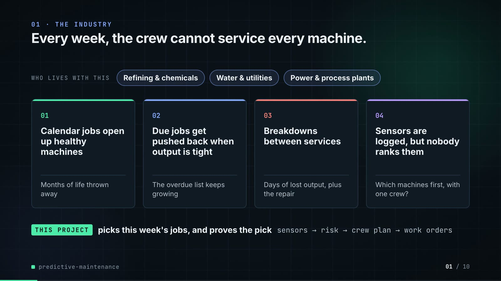

**On-screen text (verbatim)**

> 01 · THE INDUSTRY  
> Every week, the crew cannot service every machine.  
> WHO LIVES WITH THIS · Refining & chemicals · Water & utilities · Power & process plants  
> 01 Calendar jobs open up healthy machines — Months of life thrown away  
> 02 Due jobs get pushed back when output is tight — The overdue list keeps growing  
> 03 Breakdowns between services — Days of lost output, plus the repair  
> 04 Sensors are logged, but nobody ranks them — Which machines first, with one crew?  
> THIS PROJECT picks this week's jobs, and proves the pick · sensors → risk → crew plan → work orders  

**Figures on this slide**

| ID | Shown | Source · key | Calculation | Check |
|---|---|---|---|---|
| F-01 | 3 industry chips | `author's framing` · - | - | manual |
| F-02 | 4 problem cards | `README 'The problem' (problems 1-3)` · README lines 10-22 | - | ✓ |

**Assumptions:** A-10

**Illustrative, not data:**

- The whole slide is context; no repo figures.

**To change this slide:** Edit the chips (#ctx-c1..3) and cards (#ctx-k1..4) in compositions/s01-context.html. (project folder `docs/demo/source`).

### Slide 02: This project  
*6.8-11.6 s · composition `compositions/s02-hook.html`*

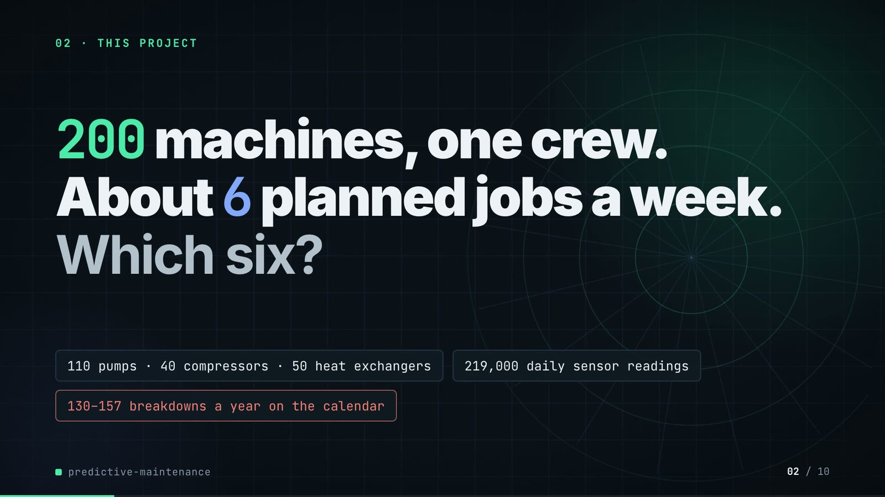

**On-screen text (verbatim)**

> 02 · THIS PROJECT  
> 200 machines, one crew. About 6 planned jobs a week. Which six?  
> 110 pumps · 40 compressors · 50 heat exchangers · 219,000 daily sensor readings · 130–157 breakdowns a year on the calendar  

**Figures on this slide**

| ID | Shown | Source · key | Calculation | Check |
|---|---|---|---|---|
| F-03 | 200 machines | `data/assets.csv` · row count | - | ✓ |
| F-04 | About 6 planned jobs a week / crew 6 jobs / week | `outputs/results.json` · crew_jobs_per_week | - | ✓ |
| F-05 | 110 pumps · 40 compressors · 50 heat exchangers | `data/assets.csv` · asset_type counts | - | ✓ |
| F-06 | 219,000 daily sensor readings / .csv.gz · 219,000 | `data/sensor_readings.csv.gz` · row count | - | ✓ |
| F-07 | 130–157 breakdowns a year on the calendar | `data/maintenance_log.csv` · kind=corrective per year: 143, 130, 157 | min..max of yearly corrective counts | ✓ |

**Assumptions:** A-01, A-04

**Illustrative, not data:**

- Rings in the background are decoration.
- 'one crew': the scheduler treats the crew as one pool (README 'Known limitations').

**To change this slide:** Headline spans #hook-l1..l3 and chips #hook-f1..f3 in compositions/s02-hook.html; plant size is config.py ASSET_TYPES. (project folder `docs/demo/source`).

### Slide 03: How it works (white chapter, slide A)  
*11.3-19.3 s · composition `compositions/explainer.html (CONFIG.blocks, CONFIG.groups, CONFIG.loop)`*

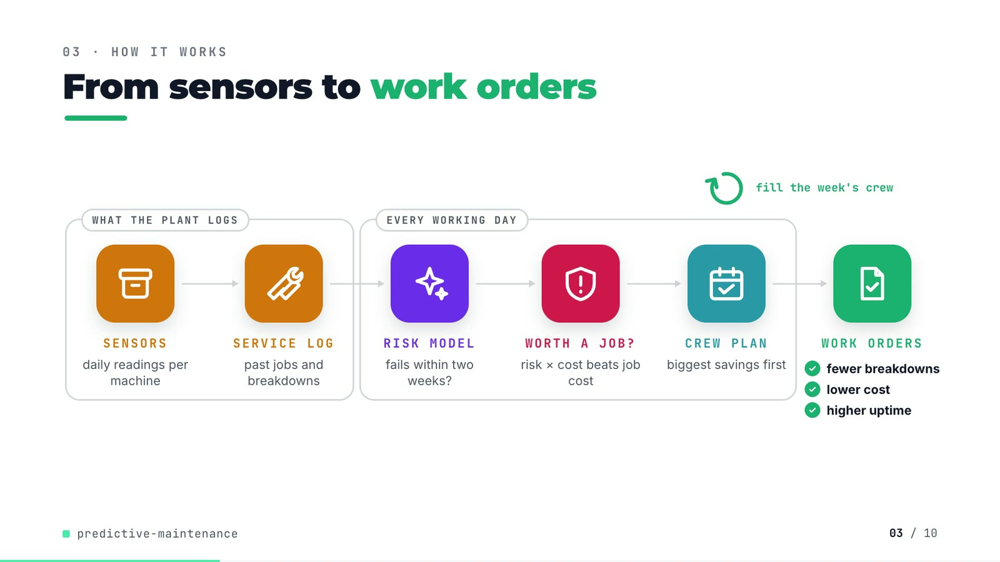

**On-screen text (verbatim)**

> 03 · HOW IT WORKS  
> From sensors to work orders  
> [WHAT THE PLANT LOGS: SENSORS daily readings per machine → SERVICE LOG past jobs and breakdowns] → [EVERY WORKING DAY: RISK MODEL fails within two weeks? → WORTH A JOB? risk × cost beats job cost → CREW PLAN biggest savings first] → WORK ORDERS ✓ fewer breakdowns ✓ lower cost ✓ higher uptime  
> fill the week's crew (loop over the crew plan)  

**Figures on this slide**

| ID | Shown | Source · key | Calculation | Check |
|---|---|---|---|---|
| F-08 | SENSORS · SERVICE LOG · RISK MODEL · WORTH A JOB? · CREW PLAN · WORK ORDERS | `src/predictive_maintenance/` · functions | - | ✓ |
| F-09 | fewer breakdowns / lower cost / higher uptime | `outputs/results.json closed_loop` · gbm-sensors vs fixed-interval at crew 6 | failures, cost_total lower; uptime higher | ✓ |
| F-10 | EVERY WORKING DAY | `src/predictive_maintenance/config.py:107` · working_days = (0..4) | - | ✓ |

**Assumptions:** A-03, A-04, A-05

**Illustrative, not data:**

- Icons and colours are a visual language, not data.

**To change this slide:** Edit CONFIG in compositions/explainer.html; badge truth is F-09. (project folder `docs/demo/source`).

### Slide 04: The key idea (white chapter, slide B)  
*19.3-26.3 s · composition `compositions/explainer.html (#ex-b ..., LOOP block injected by tools/inject_sheet.py)`*

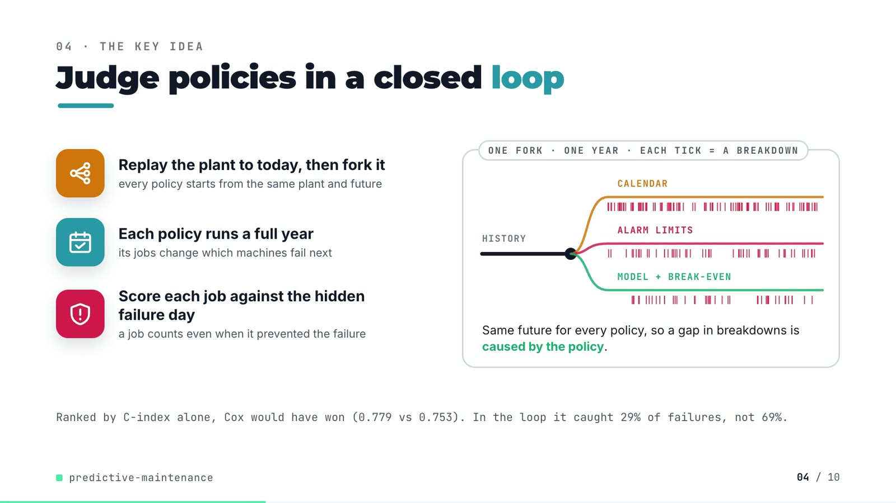

**On-screen text (verbatim)**

> 04 · THE KEY IDEA  
> Judge policies in a closed loop  
> Replay the plant to today, then fork it — every policy starts from the same plant and future  
> Each policy runs a full year — its jobs change which machines fail next  
> Score each job against the hidden failure day — a job counts even when it prevented the failure  
> ONE FORK · ONE YEAR · EACH TICK = A BREAKDOWN: HISTORY → CALENDAR / ALARM LIMITS / MODEL + BREAK-EVEN  
> Same future for every policy, so a gap in breakdowns is caused by the policy.  
> Ranked by C-index alone, Cox would have won (0.779 vs 0.753). In the loop it caught 29% of failures, not 69%.  

**Figures on this slide**

| ID | Shown | Source · key | Calculation | Check |
|---|---|---|---|---|
| F-11 | Replay the plant to today, then fork it | `src/predictive_maintenance/plant.py:281-293; tests/test_plant.py:48` · fork(); test_fork_gives_every_policy_the_same_future | - | ✓ |
| F-12 | Each policy runs a full year | `src/predictive_maintenance/cli.py (run_policy(..., DAYS_PER_YEAR, ...)); config.py:13` · DAYS_PER_YEAR = 365 | - | ✓ |
| F-13 | tick barcodes (no numbers) | `demo assets/plant_run.json (export_work_orders.py); outputs/closed_loop_runs.csv` · LOOP block in compositions/explainer.html | number of ticks per branch = failures for seed 101, crew 6 | ✓ |
| F-14 | 0.779 | `outputs/results.json` · offline.policies.cox-sensors.c_index | - | ✓ |
| F-15 | 0.753 | `outputs/results.json` · offline.policies.gbm-sensors.c_index | - | ✓ |
| F-16 | 29% | `outputs/results.json closed_loop` · cox-sensors, crew 6, failures_caught_share (0.2929) | x100, rounded | ✓ |
| F-17 | 69% | `outputs/results.json closed_loop` · gbm-sensors, crew 6, failures_caught_share (0.6868) | x100, rounded | ✓ |

**Assumptions:** A-07, A-08

**Illustrative, not data:**

- The fork drawing is schematic; tick positions are the real failure days of fork 1 (seed 101), scaled to the branch length.

**To change this slide:** Markup under #ex-b in compositions/explainer.html; ticks come from tools/inject_sheet.py (LOOP block); footnote figures are F-14..F-17. (project folder `docs/demo/source`).

### Slide 05: Architecture  
*26.0-40.8 s · composition `compositions/s03-architecture.html`*

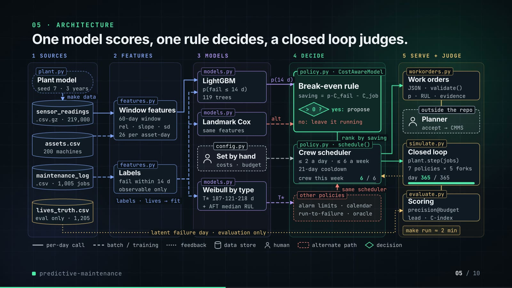

**On-screen text (verbatim)**

> 05 · ARCHITECTURE  
> One model scores, one rule decides, a closed loop judges.  
> 1 SOURCES: plant.py Plant model (seed 7 · 3 years) → make data → sensor_readings.csv.gz (219,000) · assets.csv (200 machines) · maintenance_log.csv (1,005 jobs) · lives_truth.csv (eval only · 1,205)  
> 2 FEATURES: features.py Window features (60-day window · rel · slope · sd · 26 per asset-day) · features.py Labels (fail within 14 d · observable only) · labels · lives → fit  
> 3 MODELS: models.py LightGBM (p(fail ≤ 14 d) · 119 trees) · models.py Landmark Cox (same features) · config.py Set by hand (costs · budget) · models.py Weibull by type (T* 187·121·218 d · + AFT median RUL)  
> 4 DECIDE: policy.py · CostAwareModel Break-even rule (saving = p·C_fail − C_job; > 0 ? yes: propose; no: leave it running) → rank by saving → policy.py · schedule() Crew scheduler (≤ 2 a day · ≤ 6 a week · 21-day cooldown · crew this week 0..6 / 6) · other policies (alarm limits · calendar · run-to-failure · oracle) → same scheduler  
> 5 SERVE + JUDGE: workorders.py Work orders (JSON · validate() · p · RUL · evidence) → Planner (outside the repo · accept → CMMS) · simulate.py Closed loop (plant.step(jobs) · 7 policies × 5 forks · day 0..365 / 365) → evaluate.py Scoring (precision@budget · lead · C-index) · make run ≈ 2 min  
> latent failure day · evaluation only (lives_truth.csv → Scoring)  
> critical path: readings → features → p → break-even → crew → work order  
> Legend: per-day call · batch / training · feedback · data store · human · alternate path · decision  

**Figures on this slide**

| ID | Shown | Source · key | Calculation | Check |
|---|---|---|---|---|
| F-03 | 200 machines | `data/assets.csv` · row count | - | ✓ |
| F-06 | 219,000 daily sensor readings / .csv.gz · 219,000 | `data/sensor_readings.csv.gz` · row count | - | ✓ |
| F-18 | seed 7 · 3 years | `src/predictive_maintenance/cli.py (--data-seed default 7); config.py:14` · HISTORY_YEARS = 3 | - | ✓ |
| F-19 | .csv · 1,005 jobs | `data/maintenance_log.csv` · row count | - | ✓ |
| F-20 | eval only · 1,205 | `data/lives_truth.csv` · row count | - | ✓ |
| F-21 | observable only | `src/predictive_maintenance/features.py (_labels); tests/test_features.py:33` · test_labels_drop_rows_a_preventive_job_hides | - | ✓ |
| F-22 | plant.py, features.py, models.py (LightGBM, Cox, Weibull, AFT), config.py, policy.py (CostAwareModel, schedule, other policies), workorders.py, simulate.py, evaluate.py | `src/predictive_maintenance/` · classes and functions | - | ✓ |
| F-23 | 60-day window | `src/predictive_maintenance/config.py:19` · WINDOW_DAYS = 60 | - | ✓ |
| F-24 | 26 per asset-day | `src/predictive_maintenance/features.py:20-28 (FEATURE_NAMES)` · 5 sensors x 4 + load_m7 + load_rel3 + days_since_maint + 3 type flags | 5 x 4 + 3 + 3 = 26 | ✓ |
| F-25 | p(fail ≤ 14 d) / fail within 14 d / p(14 d) | `outputs/results.json` · horizon_days | - | ✓ |
| F-26 | 119 trees | `outputs/results.json` · training.best_iteration | - | ✓ |
| F-27 | T* 187·121·218 d | `outputs/results.json` · fixed_intervals_days | - | ✓ |
| F-28 | saving = p·C_fail − C_job; > 0 ? yes: propose | `src/predictive_maintenance/policy.py:109-110` · saving = p * FAILURE_COST - PLANNED_COST; propose where saving > 0 | - | ✓ |
| F-29 | ≤ 2 a day · ≤ 6 a week · 21-day cooldown | `src/predictive_maintenance/policy.py:144-145; config.py:20, :106-107` · per_day = ceil(6 / 5); COOLDOWN_DAYS = 21 | ceil(6/5) = 2 | ✓ |
| F-30 | 7 policies × 5 forks | `outputs/closed_loop_runs.csv` · distinct policies at crew 6; distinct seeds | - | ✓ |
| F-31 | make run ≈ 2 min / ~2 min | `outputs/results.json` · runtime_seconds = 127.3 | 127.3 / 60 = 2.1 min | ✓ |
| F-32 | Planner · accept → CMMS | `src/predictive_maintenance/workorders.py:1-5 (docstring); README 'Known limitations' (schema mapping not done)` · - | - | ✓ |

**Assumptions:** A-01, A-03, A-04, A-05, A-07, A-08

**Illustrative, not data:**

- Packets moving along the wires are decoration; the day counter and crew bar animate the loop, they are not timings.
- Arrows are the main data flows, not every call (e.g. days since service from the maintenance log into the features is not drawn).

**To change this slide:** Node boxes (#n-*) and the wires array in compositions/s03-architecture.html. (project folder `docs/demo/source`).

### Slide 06: The system running  
*40.4-55.0 s · composition `compositions/s04-running.html (RUN block injected by tools/inject_sheet.py)`*

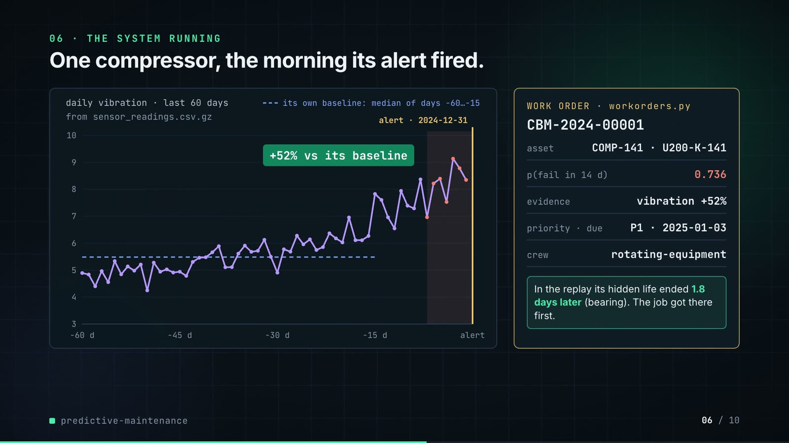

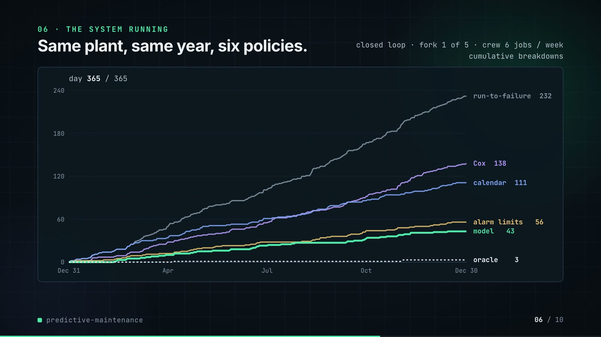

**On-screen text (verbatim)**

> 06 · THE SYSTEM RUNNING  
> One compressor, the morning its alert fired. — daily vibration · last 60 days · from sensor_readings.csv.gz · its own baseline: median of days −60…−15 · +52% vs its baseline · alert · 2024-12-31  
> WORK ORDER · workorders.py CBM-2024-00001 · asset COMP-141 · U200-K-141 · p(fail in 14 d) 0.736 · evidence vibration +52% · priority · due P1 · 2025-01-03 · crew rotating-equipment  
> In the replay its hidden life ended 1.8 days later (bearing). The job got there first.  
> Same plant, same year, six policies. — closed loop · fork 1 of 5 · crew 6 jobs / week · cumulative breakdowns · day 0..365 / 365  
> run-to-failure 232 · Cox 138 · calendar 111 · alarm limits 56 · model 43 · oracle 3  

**Figures on this slide**

| ID | Shown | Source · key | Calculation | Check |
|---|---|---|---|---|
| F-25 | p(fail ≤ 14 d) / fail within 14 d / p(14 d) | `outputs/results.json` · horizon_days | - | ✓ |
| F-33 | daily vibration · last 60 days (line chart) | `data/sensor_readings.csv.gz; demo assets/plant_run.json trace` · asset_id = COMP-141, 2024-11-01..2024-12-30 | values compared to 3 decimals | ✓ |
| F-34 | alert · 2024-12-31 | `outputs/work_orders.json` · [0].created_on | - | ✓ |
| F-35 | +52% vs its baseline / vibration +52% | `outputs/work_orders.json` · [0].evidence[0] = vibration, 0.521 | x100, rounded | ✓ |
| F-36 | CBM-2024-00001 · COMP-141 · U200-K-141 · 0.736 · P1 · 2025-01-03 · rotating-equipment | `outputs/work_orders.json` · [0] | - | ✓ |
| F-37 | hidden life ended 1.8 days later (bearing) | `demo assets/plant_run.json work_orders[0].truth (Plant.latent_remaining at the alert, fork seed 101); corroborated by data/lives_truth.csv (the same life, in the history run, ended by a bearing failure on day 731)` · latent_days_to_failure, latent_mode | - | ✓ |
| F-38 | 232 · 138 · 111 · 56 · 43 · 3 | `outputs/closed_loop_runs.csv (seed 101, crew 6); curves from demo assets/plant_run.json` · failures | - | ✓ |
| F-39 | fork 1 of 5 | `src/predictive_maintenance/config.py:108; demo assets/plant_run.json seed` · eval_seeds[0] = 101 | - | ✓ |

**Assumptions:** A-02, A-05, A-07, A-08

**Illustrative, not data:**

- Charts are drawn from exported numbers (the repo saves no plots): the trace is read from sensor_readings.csv.gz and the curves are recorded by tools/export_work_orders.py with the repo's own schedule() and Plant.step(); their year-end totals are checked against closed_loop_runs.csv (F-38).
- Baseline line is recomputed in the composition as the window median of days −60…−15, the definition in features.py.

**To change this slide:** Phase A/B markup and the RUN block in compositions/s04-running.html; re-run export_work_orders.py + inject_sheet.py after make run. (project folder `docs/demo/source`).

### Slide 07: End-user value (white)  
*54.7-67.7 s · composition `compositions/value.html (SHEET block injected by tools/inject_sheet.py)`*

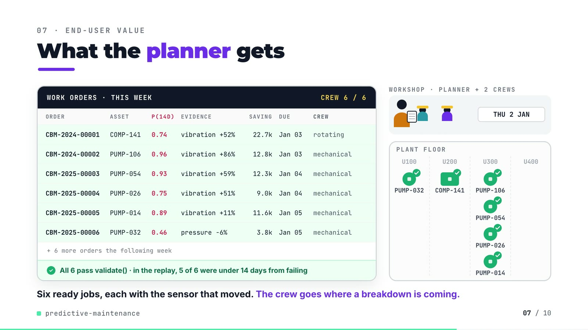

**On-screen text (verbatim)**

> 07 · END-USER VALUE  
> What the planner gets  
> WORK ORDERS · THIS WEEK · CREW 6 / 6 — columns ORDER, ASSET, P(14D), EVIDENCE, SAVING, DUE, CREW  
> CBM-2024-00001 COMP-141 0.74 vibration +52% 22.7k Jan 03 rotating  
> CBM-2024-00002 PUMP-106 0.96 vibration +86% 12.8k Jan 03 mechanical  
> CBM-2025-00003 PUMP-054 0.93 vibration +59% 12.3k Jan 04 mechanical  
> CBM-2025-00004 PUMP-026 0.75 vibration +51% 9.0k Jan 04 mechanical  
> CBM-2025-00005 PUMP-014 0.89 vibration +11% 11.6k Jan 05 mechanical  
> CBM-2025-00006 PUMP-032 0.46 pressure -6% 3.8k Jan 05 mechanical  
> + 6 more orders the following week · ✓ All 6 pass validate() · in the replay, 5 of 6 were under 14 days from failing  
> WORKSHOP · PLANNER + 2 CREWS · TUE 31 DEC / WED 1 JAN / THU 2 JAN · PLANT FLOOR U100 U200 U300 U400  
> Six ready jobs, each with the sensor that moved. The crew goes where a breakdown is coming.  

**Figures on this slide**

| ID | Shown | Source · key | Calculation | Check |
|---|---|---|---|---|
| F-35 | +52% vs its baseline / vibration +52% | `outputs/work_orders.json` · [0].evidence[0] = vibration, 0.521 | x100, rounded | ✓ |
| F-40 | CBM-2024-00001 … CBM-2025-00006 | `outputs/work_orders.json [0:6], injected into compositions/value.html` · work_order_id, asset_id, failure_probability, evidence[0], expected_saving, due_by, crew | p to 2 dp; saving / 1000 to 1 dp; crew shortened (rotating-equipment → rotating) | ✓ |
| F-41 | + 6 more orders the following week | `outputs/results.json` · work_orders_first_two_weeks = 12 | 12 - 6 | ✓ |
| F-42 | All 6 pass validate() | `src/predictive_maintenance/cli.py (assert not bad); tools/export_work_orders.py asserts the same` · validate() | - | ✓ |
| F-43 | 5 of 6 were under 14 days from failing | `demo assets/plant_run.json work_orders[0:6].truth` · latent_days_to_failure: 1.8, 0.3, 5.0, 11.0, 3.3, 18.1 | count(0 < d <= 14) | ✓ |
| F-44 | CREW 6 / 6 | `outputs/work_orders.json` · orders created 2024-12-30..2025-01-03 | count | ✓ |
| F-45 | TUE 31 DEC · WED 1 JAN · THU 2 JAN | `outputs/work_orders.json` · created_on of orders 1-6 | - | ✓ |

**Assumptions:** A-03, A-04, A-08, A-09

**Illustrative, not data:**

- Planner, the two crews (the repo has one crew pool with typed crew labels), hard hats, machine drawings and walking speed are illustrative.
- Machines are placed in the unit from their functional location (U100-U400); positions inside a unit are not real.
- SAVING is the model's expected saving (p x failure cost - planned cost), not a realised saving.
- '5 of 6' uses the plant's latent truth, which a real planner would not see.

**To change this slide:** Re-run tools/export_work_orders.py, then tools/inject_sheet.py (--rows picks the orders); layout in compositions/value.html. (project folder `docs/demo/source`).

### Slide 08: Results  
*67.4-76.2 s · composition `compositions/s05-results.html (stats array)`*

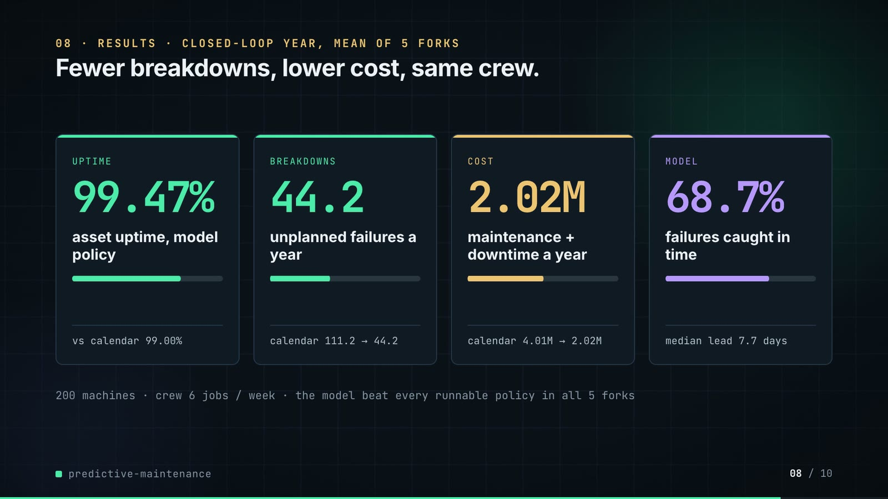

**On-screen text (verbatim)**

> 08 · RESULTS · CLOSED-LOOP YEAR, MEAN OF 5 FORKS  
> Fewer breakdowns, lower cost, same crew.  
> UPTIME 99.47% asset uptime, model policy · vs calendar 99.00%  
> BREAKDOWNS 44.2 unplanned failures a year · calendar 111.2 → 44.2  
> COST 2.02M maintenance + downtime a year · calendar 4.01M → 2.02M  
> MODEL 68.7% failures caught in time · median lead 7.7 days  
> 200 machines · crew 6 jobs / week · the model beat every runnable policy in all 5 forks  

**Figures on this slide**

| ID | Shown | Source · key | Calculation | Check |
|---|---|---|---|---|
| F-03 | 200 machines | `data/assets.csv` · row count | - | ✓ |
| F-04 | About 6 planned jobs a week / crew 6 jobs / week | `outputs/results.json` · crew_jobs_per_week | - | ✓ |
| F-46 | 99.47% | `outputs/results.json closed_loop` · gbm-sensors, crew 6, uptime | x100 | ✓ |
| F-47 | vs calendar 99.00% | `outputs/results.json closed_loop` · fixed-interval, crew 6, uptime | x100 | ✓ |
| F-49 | 44.2 | `outputs/results.json closed_loop` · gbm-sensors, crew 6, failures | - | ✓ |
| F-50 | calendar 111.2 | `outputs/results.json closed_loop` · fixed-interval, crew 6, failures | - | ✓ |
| F-51 | 2.02M | `outputs/results.json closed_loop` · gbm-sensors, crew 6, cost_total = 2,015,700 | / 1e6 | ✓ |
| F-52 | 4.01M | `outputs/results.json closed_loop` · fixed-interval, crew 6, cost_total = 4,009,400 | / 1e6 | ✓ |
| F-53 | 68.7% | `outputs/results.json closed_loop` · gbm-sensors, crew 6, failures_caught_share | x100 | ✓ |
| F-54 | median lead 7.7 days | `outputs/results.json closed_loop` · gbm-sensors, crew 6, median_lead_days | - | ✓ |
| F-55 | the model beat every runnable policy in all 5 forks | `outputs/results.json` · paired_gbm_minus.*.seeds_gbm_better_uptime | all == 5 | ✓ |

**Assumptions:** A-03, A-04, A-06, A-07, A-09

**Illustrative, not data:**

- Mini bars: uptime bar = model gain / oracle gain over calendar (0.47 / 0.66); failures and cost bars = after / before; caught bar = 68.7%.

**To change this slide:** The stats array and card text in compositions/s05-results.html. (project folder `docs/demo/source`).

### Slide 09: What didn't win  
*75.8-82.0 s · composition `compositions/s06-twist.html`*

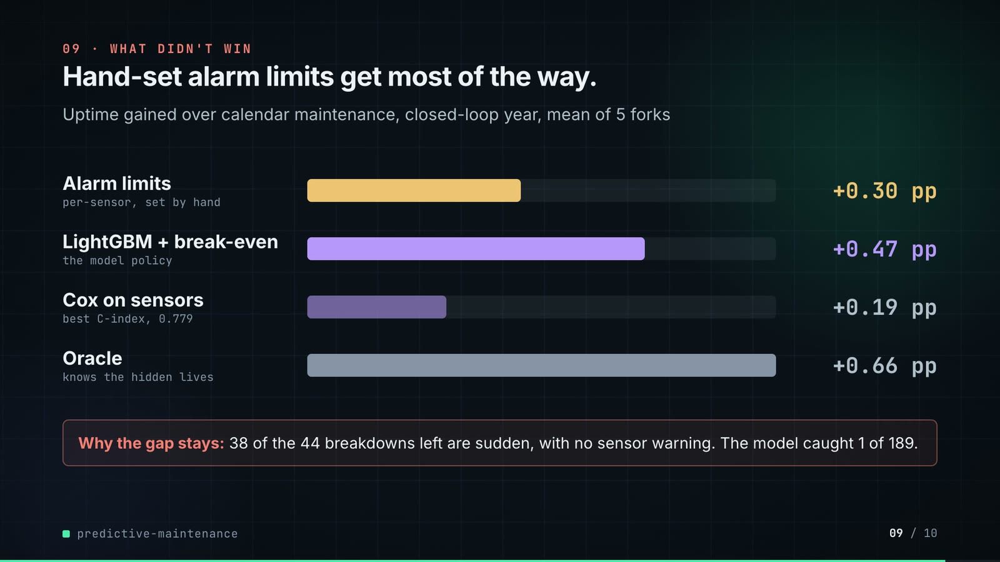

**On-screen text (verbatim)**

> 09 · WHAT DIDN'T WIN  
> Hand-set alarm limits get most of the way.  
> Uptime gained over calendar maintenance, closed-loop year, mean of 5 forks  
> Alarm limits (per-sensor, set by hand) +0.30 pp · LightGBM + break-even (the model policy) +0.47 pp · Cox on sensors (best C-index, 0.779) +0.19 pp · Oracle (knows the hidden lives) +0.66 pp  
> Why the gap stays: 38 of the 44 breakdowns left are sudden, with no sensor warning. The model caught 1 of 189.  

**Figures on this slide**

| ID | Shown | Source · key | Calculation | Check |
|---|---|---|---|---|
| F-14 | 0.779 | `outputs/results.json` · offline.policies.cox-sensors.c_index | - | ✓ |
| F-48 | +0.47 pp | `outputs/results.json` · paired_gbm_minus.fixed-interval.uptime_pp_mean | - | ✓ |
| F-56 | +0.30 pp | `outputs/results.json closed_loop` · alarm-limits uptime - fixed-interval uptime (crew 6) | (0.992978 - 0.989989) x 100 = 0.299 | ✓ |
| F-57 | +0.19 pp | `outputs/results.json closed_loop` · cox-sensors uptime - fixed-interval uptime (crew 6) | (0.991939 - 0.989989) x 100 = 0.195 | ✓ |
| F-58 | +0.66 pp | `outputs/results.json closed_loop` · oracle uptime - fixed-interval uptime (crew 6) | (0.996549 - 0.989989) x 100 = 0.656 | ✓ |
| F-59 | 38 of the 44 breakdowns left are sudden | `outputs/closed_loop_runs.csv` · gbm-sensors, crew 6: mean sudden_failures 37.6, mean failures 44.2 | rounded to whole numbers | ✓ |
| F-60 | The model caught 1 of 189 | `outputs/results.json` · gbm_caught_by_mode.sudden | - | ✓ |

**Assumptions:** A-02, A-07, A-09

**Illustrative, not data:**

- Bar lengths: 900 px track = 0.66 pp (the oracle).

**To change this slide:** Rows #twist-r1..r4 (bar widths are inline styles) in compositions/s06-twist.html. (project folder `docs/demo/source`).

### Slide 10: End card  
*81.6-86.0 s · composition `compositions/s07-end.html`*

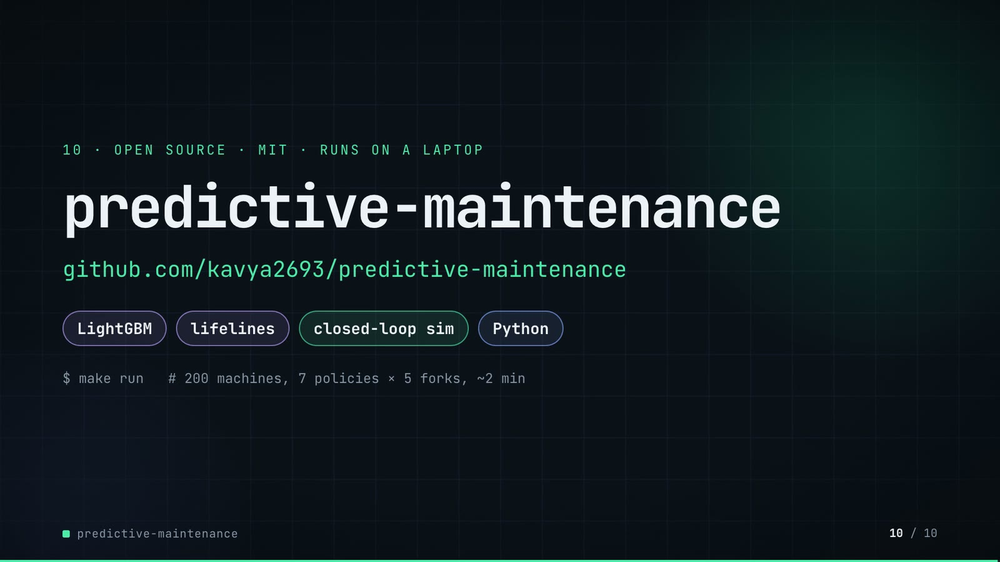

**On-screen text (verbatim)**

> 10 · OPEN SOURCE · MIT · RUNS ON A LAPTOP  
> predictive-maintenance  
> github.com/kavya2693/predictive-maintenance  
> LightGBM · lifelines · closed-loop sim · Python  
> $ make run   # 200 machines, 7 policies × 5 forks, ~2 min  

**Figures on this slide**

| ID | Shown | Source · key | Calculation | Check |
|---|---|---|---|---|
| F-30 | 7 policies × 5 forks | `outputs/closed_loop_runs.csv` · distinct policies at crew 6; distinct seeds | - | ✓ |
| F-31 | make run ≈ 2 min / ~2 min | `outputs/results.json` · runtime_seconds = 127.3 | 127.3 / 60 = 2.1 min | ✓ |
| F-61 | MIT | `LICENSE line 1` · - | - | ✓ |
| F-62 | LightGBM · lifelines · closed-loop sim · Python | `pyproject.toml dependencies; src/predictive_maintenance/simulate.py` · lightgbm, lifelines | - | ✓ |
| F-63 | $ make run | `Makefile` · run target | - | ✓ |

**Assumptions:** A-09

**To change this slide:** Text in compositions/s07-end.html. (project folder `docs/demo/source`).

## 5. Change-impact matrix

| Input / assumption | Affected figures | Affected slides | Files to edit | Commands to re-run |
|---|---|---|---|---|
| A-01: All data is synthetic: a seeded day-by-day plant model (200 assets, 3 years) generates the sensor history, the maintenance log and the latent lives | all figures | 01, 02, 03, 04, 05, 06, 07, 08, 09, 10 | `src/predictive_maintenance/config.py; src/predictive_maintenance/plant.py` | `make data; make run; export_work_orders.py + inject_sheet.py` |
| A-02: Failure precursors: each failure mode drifts the sensors for a mode-specific number of days before the failure (bearing 21 d, fouling 35 d, overheating 4 d,  | F-17, F-34, F-35, F-37, F-53, F-54, F-59, F-60 | 04, 06, 07, 08, 09 | `src/predictive_maintenance/config.py:93-101` | `make data; make run; export_work_orders.py + inject_sheet.py` |
| A-03: Costs: a planned job costs 1,500 plus one day of downtime; a failure costs its repair (9k pump, 22k compressor, 12k heat exchanger) plus 3-5 days of downtime at 3,000 a day | F-28, F-40, F-51, F-52 | 05, 07, 08 | `src/predictive_maintenance/config.py:32-34 and the AssetType blocks` | `make run; export_work_orders.py + inject_sheet.py` |
| A-04: Crew budget: 6 planned jobs a week, Monday to Friday, at most ceil(6/5) = 2 a day; an asset serviced in the last 21 days is not offered again | F-04, F-29, F-44, F-45, F-46, F-49, F-51, F-53 | 02, 05, 07, 08 | `src/predictive_maintenance/config.py:106, :20` | `make run; export_work_orders.py + inject_sheet.py` |
| A-05: Prediction horizon 14 days, feature window 60 days, baseline = window median excluding the last 14 days | F-23, F-25, F-34, F-35 | 05, 06, 07 | `src/predictive_maintenance/config.py:18-19; src/predictive_maintenance/features.py:18` | `make run; export_work_orders.py + inject_sheet.py` |
| A-06: Every job is a perfect repair (the asset is as good as new); imperfect repair and infant mortality are not modelled | F-46, F-49, F-51, F-53 | 08 | `src/predictive_maintenance/plant.py` | `make run` |
| A-07: Closed-loop evaluation: the plant is replayed to the end of the 2-year training history (2024-12-31), forked with seeds 101-105, and each policy runs 365 days from the same fork with the same random stream | F-11, F-12, F-13, F-30, F-38, F-39, F-46, F-47, F-48, F-49, F-50, F-51, F-52, F-53, F-54, F-55, F-56, F-57, F-58, F-59 | 04, 05, 06, 08, 09, 10 | `src/predictive_maintenance/config.py:108` | `make run; export_work_orders.py + inject_sheet.py` |
| A-08: Truth for scoring: an alert is a catch when the asset's latent life would have ended within 14 days; the latent failure day comes from the plant model (lives_truth | F-16, F-17, F-37, F-43, F-53, F-60 | 04, 06, 07, 08, 09 | `src/predictive_maintenance/simulate.py` | `make run` |
| A-09: Video rounding: uptime to 2 decimals, percentages to whole numbers or 1 decimal as shown, costs in millions to 2 decimals, savings in thousands to 1 decimal, failure probability to 2 decimals on the sheet (3 on the work-order card), failure means to 1 decimal or whole numbers as shown | F-07, F-16, F-17, F-31, F-35, F-40, F-46, F-47, F-48, F-49, F-50, F-51, F-52, F-53, F-54, F-56, F-57, F-58, F-59 | 02, 04, 05, 06, 07, 08, 09, 10 | `the composition file named on each slide` | `hyperframes render` |
| A-10: Slide 01 (industries, everyday problems) is general maintenance knowledge used as context; it is not a result of this repo and carries no numbers | F-01, F-02 | 01 | `compositions/s01-context.html` | `hyperframes render` |

## 6. Known differences and caveats

- The biggest gap (README): the same plant model generated the training data and runs the evaluation, so every result says the method works on a plant with these physics, not what it would achieve on a given real plant.
- Slides 04 and 06 show one fork (seed 101); slides 08-09 show the mean of five forks. Seed-101 totals (e.g. model 43 failures) differ from the 5-fork means (44.2).
- 'Hidden life ended 1.8 days later' and '5 of 6 under 14 days from failing' use the plant's latent truth (Plant.latent_remaining), which exists only in simulation.
- Expected saving on the sheet is the model's own estimate (p x failure cost - planned cost); it is not a realised saving.
- The repo saves no plots; slide 06 charts are drawn from exported numbers (F-33, F-38), not from matplotlib output.
- '+0.47 pp' is the paired mean from results.json; it equals the difference of the two 5-fork mean uptimes.
- Precision at budget (46%) is not on screen: half the model's jobs land on an asset that would not have failed inside 14 days (README 'What disappoints').
- Slide 01 statements are general industry knowledge (A-10).

## Appendix: environment

- Commit: `70531ff3190a5ff2de81b5edc3ef1ee5888ae47c`
- Python: 3.11.7
- lightgbm 4.7.0
- lifelines 0.30.3
- pandas 2.3.3
- numpy 2.4.6
- sklearn 1.9.1
- Profile / seeds: data_seed=7, closed_loop_seeds=101-105 (5 forks), fork_shown_on_slides_04_06=101, lightgbm_random_state=0
- Run time: results.json runtime_seconds = 127.3 s (about 2 min) for make run on the author's laptop
